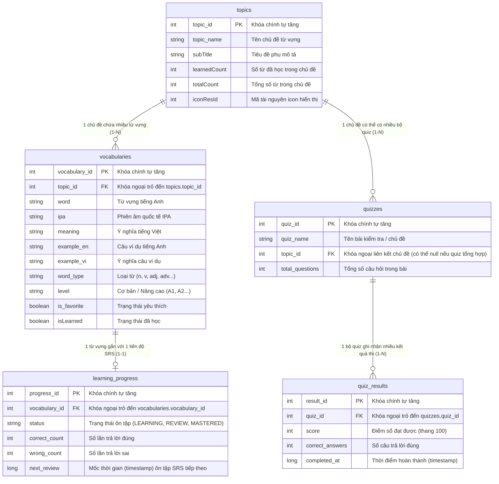
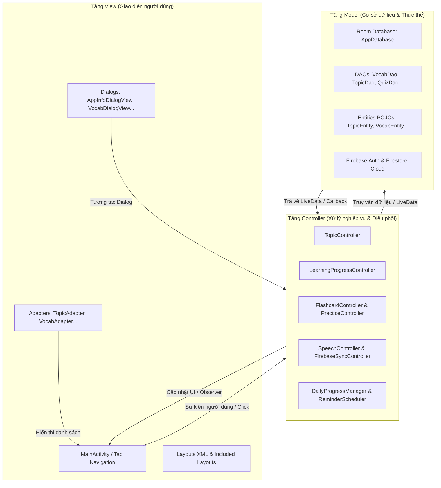

# BÁO CÁO TIẾN ĐỘ ĐỒ ÁN: ỨNG DỤNG HỌC TỪ VỰNG TIẾNG ANH "VOCABMASTER"
**Môn học / Dự án:** Phát triển ứng dụng di động Android (Mô hình MVC & Offline-First)  
**Package ứng dụng:** `com.example.vocabmaster`  
**Giai đoạn báo cáo:** Tuần 3 & Tuần 4  

---

## PHẦN 1: TUẦN 3 – CƠ SỞ DỮ LIỆU VÀ KIẾN TRÚC

### 1. Thiết kế mô hình dữ liệu (ERD) & Đặc tả các bảng

#### Sơ đồ thực thể kết hợp (ERD)
Dưới đây là sơ đồ ERD thể hiện 5 bảng trong Room Database của ứng dụng `VocabMaster` được biểu diễn bằng cú pháp Mermaid (`erDiagram`), thể hiện rõ khóa chính (PK), khóa ngoại (FK) và lực lượng quan hệ:



#### Bảng đặc tả chi tiết các Entity trong Room Database
1. **Bảng `topics` (`TopicEntity`)**: Quản lý các chủ đề từ vựng chính.
   - `topic_id`: Kiểu `int` | Ràng buộc: `PK`, `AutoGenerate`, `Not Null` | Ý nghĩa: Mã định danh duy nhất của chủ đề.
   - `topic_name`: Kiểu `String` | Ràng buộc: `Not Null` | Ý nghĩa: Tên chủ đề (Ví dụ: Gia đình, Trường học, Công việc...).
   - `subTitle`: Kiểu `String` | Ràng buộc: `Nullable` | Ý nghĩa: Mô tả ngắn gọn chủ đề.
   - `learnedCount`: Kiểu `int` | Ràng buộc: `Not Null` (mặc định 0) | Ý nghĩa: Số lượng từ vựng đã học trong chủ đề.
   - `totalCount`: Kiểu `int` | Ràng buộc: `Not Null` (mặc định 0) | Ý nghĩa: Tổng số từ vựng thuộc chủ đề.
   - `iconResId`: Kiểu `int` | Ràng buộc: `Not Null` | Ý nghĩa: ID resource hình ảnh icon minh họa.

2. **Bảng `vocabularies` (`VocabEntity`)**: Lưu trữ từ vựng chi tiết.
   - `vocabulary_id`: Kiểu `int` | Ràng buộc: `PK`, `AutoGenerate`, `Not Null` | Ý nghĩa: Mã định danh từ vựng.
   - `topic_id`: Kiểu `int` | Ràng buộc: `FK` (`topics.topic_id`), `Not Null` | Ý nghĩa: Liên kết từ vựng với chủ đề cha.
   - `word`: Kiểu `String` | Ràng buộc: `Not Null` | Ý nghĩa: Từ vựng tiếng Anh.
   - `ipa`: Kiểu `String` | Ràng buộc: `Nullable` (ColumnInfo: `ipa`) | Ý nghĩa: Phiên âm quốc tế.
   - `meaning`: Kiểu `String` | Ràng buộc: `Not Null` | Ý nghĩa: Nghĩa tiếng Việt.
   - `example_en`: Kiểu `String` | Ràng buộc: `Nullable` (ColumnInfo: `example_en`) | Ý nghĩa: Câu ví dụ tiếng Anh.
   - `example_vi`: Kiểu `String` | Ràng buộc: `Nullable` (ColumnInfo: `example_vi`) | Ý nghĩa: Dịch nghĩa câu ví dụ.
   - `word_type`: Kiểu `String` | Ràng buộc: `Nullable` (ColumnInfo: `word_type`) | Ý nghĩa: Từ loại (danh từ, động từ...).
   - `level`: Kiểu `String` | Ràng buộc: `Nullable` | Ý nghĩa: Cấp độ khó (A1, A2...).
   - `is_favorite`: Kiểu `boolean` | Ràng buộc: `Not Null` (ColumnInfo: `is_favorite`) | Ý nghĩa: Đánh dấu từ yêu thích.
   - `isLearned`: Kiểu `boolean` | Ràng buộc: `Not Null` | Ý nghĩa: Đánh dấu đã học.

3. **Bảng `learning_progress` (`LearningProgressEntity`)**: Theo dõi tiến độ học tập và thuật toán SRS.
   - `progress_id`: Kiểu `int` | Ràng buộc: `PK`, `AutoGenerate`, `Not Null` | Ý nghĩa: Mã bản ghi tiến độ.
   - `vocabulary_id`: Kiểu `int` | Ràng buộc: `FK` (`vocabularies.vocabulary_id`), `Unique Index`, `Not Null` | Ý nghĩa: Liên kết 1-1 với từ vựng.
   - `status`: Kiểu `String` | Ràng buộc: `Not Null` | Ý nghĩa: Trạng thái SRS (`LEARNING`, `REVIEW`, `MASTERED`).
   - `correct_count`: Kiểu `int` | Ràng buộc: `Not Null` (ColumnInfo: `correct_count`) | Ý nghĩa: Số lần trả lời đúng liên tiếp.
   - `wrong_count`: Kiểu `int` | Ràng buộc: `Not Null` (ColumnInfo: `wrong_count`) | Ý nghĩa: Số lần trả lời sai.
   - `next_review`: Kiểu `long` | Ràng buộc: `Not Null` (ColumnInfo: `next_review`) | Ý nghĩa: Thời điểm mốc thời gian timestamp ôn tập tiếp theo.

4. **Bảng `quizzes` (`QuizEntity`)**: Quản lý thông tin các bài kiểm tra.
   - `quiz_id`: Kiểu `int` | Ràng buộc: `PK`, `AutoGenerate`, `Not Null` | Ý nghĩa: Mã bài quiz.
   - `quiz_name`: Kiểu `String` | Ràng buộc: `Not Null` (ColumnInfo: `quiz_name`) | Ý nghĩa: Tiêu đề bài kiểm tra.
   - `topic_id`: Kiểu `Integer` | Ràng buộc: `FK` (`topics.topic_id`), `Nullable` (ColumnInfo: `topic_id`) | Ý nghĩa: Mã chủ đề liên quan (nếu có).
   - `total_questions`: Kiểu `int` | Ràng buộc: `Not Null` (ColumnInfo: `total_questions`) | Ý nghĩa: Tổng số câu hỏi trong bài quiz.

5. **Bảng `quiz_results` (`QuizResultEntity`)**: Lưu trữ lịch sử kết quả thi trắc nghiệm.
   - `result_id`: Kiểu `int` | Ràng buộc: `PK`, `AutoGenerate`, `Not Null` | Ý nghĩa: Mã bản ghi kết quả.
   - `quiz_id`: Kiểu `int` | Ràng buộc: `FK` (`quizzes.quiz_id`), `Not Null` (ColumnInfo: `quiz_id`) | Ý nghĩa: Liên kết đến bài quiz tương ứng.
   - `score`: Kiểu `int` | Ràng buộc: `Not Null` | Ý nghĩa: Điểm số đạt được (thang 100).
   - `correct_answers`: Kiểu `int` | Ràng buộc: `Not Null` (ColumnInfo: `correct_answers`) | Ý nghĩa: Số câu trả lời đúng thực tế.
   - `completed_at`: Kiểu `long` | Ràng buộc: `Not Null` (ColumnInfo: `completed_at`) | Ý nghĩa: Thời gian hoàn thành bài thi (timestamp).

#### Các lớp POJO hỗ trợ truy vấn phức hợp
- `TopicProgress`: Chứa các trường `totalWords`, `flashcardCount`, `quizCount` dùng để tính phần trăm hoàn thành Flashcard và Quiz cho từng chủ đề.
- `QuizResultWithQuiz`: Kết hợp dữ liệu từ `quiz_results` và `quizzes` qua lệnh `INNER JOIN` nhằm hiển thị danh sách lịch sử thi kèm tên bài quiz và tổng số câu.
- `DashboardStats`: Đóng gói toàn bộ số liệu thống kê tổng quan hiển thị trên trang chủ (`learnedCount`, `quizCompleted`, `totalCorrectQuiz`, `accuracy`, `wrongCount`, `customCount`, `todayCount`, `dailyGoal`, `dailyPercent`, `dailyGoalStatus`).
- `ProficiencyReport`: Tổng hợp đánh giá năng lực học viên (`level`, `accuracy`, `masteredCount`, `totalVocabs`, `feedbackMessage`).
- `PronunciationResult`: Kết quả đánh giá phát âm qua Speech-to-Text (`targetWord`, `recognizedWord`, `isCorrect`, `feedback`).

#### Cơ chế ràng buộc toàn vẹn cơ sở dữ liệu
- **`ForeignKey.CASCADE`**: Được áp dụng trên tất cả các khóa ngoại giữa `vocabularies`, `learning_progress`, `quizzes`, `quiz_results` đối với bảng cha. Khi một chủ đề hoặc từ vựng bị xóa, toàn bộ tiến độ, lịch sử và từ vựng con liên quan sẽ được tự động dọn dẹp, tránh dữ liệu mồ côi (orphan records).
- **Sử dụng lệnh `@Update` và câu lệnh `UPDATE` cụ thể thay vì `@Insert(onConflict = REPLACE)` cho các thao tác cập nhật trạng thái (`updateLearnedStatus`, `updateFavoriteStatus`, `updateTopicLearnedCount`)**: Giúp tránh việc ghi đè vô tình làm mất các cột dữ liệu khác hoặc sinh xung đột khóa chính không cần thiết, đảm bảo tính toàn vẹn dữ liệu ngoại vi.

---

### 2. Lựa chọn giải pháp lưu trữ (Offline-First: Room SQLite + Firebase Cloud Firestore + SharedPreferences)

#### Lý do kết hợp kiến trúc lưu trữ đa tầng
  1. **Room Database (SQLite cục bộ)**: 
    - Đóng vai trò là nguồn dữ liệu chính (Source of Truth) cho ứng dụng theo mô hình Offline-First. 
    - Ứng dụng được khởi tạo sẵn cơ sở dữ liệu từ file assets (`databases/vocabulary_app.db`), giúp người dùng có thể mở app và học từ vựng ngay lập tức với tốc độ cực nhanh mà không cần kết nối mạng internet.
  2. **Firebase Cloud Firestore**: 
    - Cung cấp dịch vụ đám mây NoSQL để sao lưu dữ liệu cá nhân hóa của người dùng (từ vựng tự thêm, trạng thái học `isLearned`, `isFavorite`, tiến độ SRS, lịch sử thi và cài đặt học tập).
    - Cho phép đồng bộ hóa dữ liệu hai chiều (Push & Pull/Merge) khi người dùng đăng nhập tài khoản, giúp chuyển đổi thiết bị mượt mà không lo mất tiến độ.
  3. **SharedPreferences (`DailyProgressManager`)**: 
    - Lưu trữ các cấu hình nhẹ và nhanh như: Mục tiêu học tập hằng ngày (`dailyGoal`), số từ đã học trong ngày (`todayWordsCount`), tổng số bài quiz đã hoàn thành (`totalQuizCompleted`), cài đặt giọng đọc TTS (`ttsLocale`, `ttsSpeed`), và cấu hình nhắc nhở hằng ngày (`reminderHour`, `reminderMinute`, `reminderEnabled`).

#### Cấu trúc cây Document / Collection trên Cloud Firestore
Cấu trúc lưu trữ trên Firestore tuân theo phân cấp tài khoản người dùng (`users/{uid}`):
```text
cloud_firestore_root/
└── users/
    └── {uid}/
        ├── settings/
        │   └── daily_settings  (dailyGoal, todayWordsCount, totalQuizCompleted, ttsLocale, ttsSpeed, reminderHour, reminderMinute, reminderEnabled, updatedAt)
        ├── custom_vocabs/
        │   └── {vocabId}       (vocabId, topicId, word, phonetic, meaning, example, exampleMeaning, isLearned, isFavorite, updatedAt)
        ├── vocab_states/
        │   └── {vocabId}       (vocabId, topicId, isLearned, isFavorite, status, correctCount, wrongCount, nextReview, updatedAt)
        └── quiz_results/
            └── {completedAt}   (quizName, topicId, totalQuestions, score, correctAnswers, completedAt)
```

---

### 3. Kiến trúc ứng dụng (MVC) & Cấu trúc thư mục

#### Sơ đồ kiến trúc MVC (Model – View – Controller)
Sơ đồ dưới đây minh họa luồng giao tiếp giữa các thành phần trong ứng dụng `VocabMaster`:



#### Cây cấu trúc thư mục thực tế (`src/main/java/...` và `src/main/res/`)
```text
com.example.vocabmaster/
├── controller/
│   ├── DailyProgressManager.java     (Quản lý tiến độ ngày & SharedPreferences)
│   ├── FirebaseSyncController.java   (Xử lý Auth Email/Pass, Google Sign-In & Sync 2 chiều)
│   ├── FlashcardController.java      (Xử lý logic lật thẻ Flashcard 3D)
│   ├── LearningProgressController.java (Tính toán SRS, thống kê Dashboard & báo cáo năng lực)
│   ├── MainActivity.java             (Activity trung tâm điều phối 4 Tab & sự kiện chính)
│   ├── PracticeController.java       (Xử lý logic bộ câu hỏi trắc nghiệm & chấm điểm)
│   ├── ReminderReceiver.java         (BroadcastReceiver nhận lịch hẹn AlarmManager phát thông báo)
│   ├── ReminderScheduler.java        (Cấu hình AlarmManager hẹn giờ nhắc nhở hằng ngày)
│   ├── SpeechController.java         (Quản lý Text-to-Speech TTS US/UK & Intent STT)
│   └── TopicController.java          (Quản lý danh sách chủ đề, từ vựng, tìm kiếm & bộ lọc)
├── model/
│   ├── dao/
│   │   ├── LearningProgressDao.java  (Truy vấn bảng tiến độ học tập & SRS)
│   │   ├── QuizDao.java              (Truy vấn bảng quản lý bài quiz)
│   │   ├── QuizResultDao.java        (Truy vấn lịch sử thi kết quả quiz)
│   │   ├── TopicDao.java             (Truy vấn danh sách chủ đề & đếm từ)
│   │   └── VocabDao.java             (Truy vấn từ vựng, tìm kiếm LIKE, JOIN tiến độ)
│   ├── database/
│   │   └── AppDatabase.java          (Khởi tạo Room Database từ assets/vocabulary_app.db)
│   └── entity/
│       ├── DashboardStats.java       (POJO thống kê tổng quan trang chủ)
│       ├── LearningProgressEntity.java (Entity bảng learning_progress)
│       ├── ProficiencyReport.java    (POJO báo cáo đánh giá năng lực)
│       ├── PronunciationResult.java  (POJO kết quả đánh giá phát âm STT)
│       ├── QuizEntity.java           (Entity bảng quizzes)
│       ├── QuizResultEntity.java     (Entity bảng quiz_results)
│       ├── QuizResultWithQuiz.java   (POJO INNER JOIN kết quả và tên quiz)
│       ├── TopicEntity.java          (Entity bảng topics)
│       ├── TopicProgress.java        (POJO tính tiến độ % theo chủ đề)
│       └── VocabEntity.java          (Entity bảng vocabularies)
└── view/
    ├── adapter/
    │   ├── OverallProgressAdapter.java (Adapter hiển thị tiến độ tổng quan theo chủ đề)
    │   ├── QuizHistoryAdapter.java     (Adapter hiển thị lịch sử làm bài kiểm tra)
    │   ├── TopicAdapter.java         (Adapter hiển thị lưới các chủ đề từ vựng)
    │   └── VocabAdapter.java         (Adapter hiển thị danh sách từ vựng chi tiết)
    ├── dialog/
    │   ├── AppInfoDialogView.java    (Quản lý các BottomSheetDialog: Auth/Sync, Profile, Settings...)
    │   ├── FlashcardDialogView.java  (Quản lý giao diện lật thẻ Flashcard)
    │   ├── PracticeDialogView.java   (Quản lý giao diện thi trắc nghiệm Quiz & kết quả)
    │   └── VocabDialogView.java      (Quản lý Dialog thêm từ mới, chi tiết từ, tìm kiếm & STT)
    └── helper/
        └── ProgressAnimHelper.java   (Hỗ trợ hiệu ứng animation vòng tròn, thanh tiến độ & scroll)
```
*Ghi chú kiến trúc View:* File `activity_main.xml` được thiết kế cực kỳ gọn gàng bằng cách tách biệt từng màn hình Tab (`layout_tab_home.xml`, `layout_tab_test.xml`, `layout_tab_word_list.xml`, `layout_tab_info.xml`, `layout_screen_topic_detail.xml`) thông qua thẻ `<include>`, đồng thời toàn bộ các hộp thoại tương tác phức tạp được đóng gói vào gói `view/dialog/` giúp mã nguồn dễ bảo trì và mở rộng.

---

### 4. Các thao tác CRUD cơ bản

Dưới đây là các phương thức thực tế được trích dẫn từ tầng DAO và Controller minh họa đầy đủ 4 thao tác CRUD (Create, Read, Update, Delete):

#### 1. Create (Thêm mới dữ liệu)
- **Thêm từ vựng tùy chỉnh (`TopicController.java` & `VocabDao.java`)**:
  ```java
  public void addCustomVocab(VocabEntity vocab, Runnable onSuccess) {
      executor.execute(() -> {
          long id = db.vocabDao().insertVocab(vocab);
          db.topicDao().updateTopicTotalCount(vocab.getTopicId());
          if (isLoggedIn()) {
              FirebaseSyncController.getInstance().pushCustomVocab(vocab);
          }
          if (onSuccess != null) mainHandler.post(onSuccess);
      });
  }
  ```
- **Lưu kết quả bài kiểm tra (`QuizResultDao.java`)**:
  ```java
  @Insert(onConflict = OnConflictStrategy.REPLACE)
  long insertResult(QuizResultEntity result);
  ```

#### 2. Read (Đọc và truy vấn dữ liệu)
- **Lấy danh sách chủ đề theo LiveData (`TopicDao.java`)**:
  ```java
  @Query("SELECT * FROM topics")
  LiveData<List<TopicEntity>> getAllTopicsLiveData();
  ```
- **Truy vấn tiến độ kết hợp `LEFT JOIN` (`VocabDao.java`)**:
  ```java
  @Query("SELECT COUNT(DISTINCT v.vocabulary_id) AS totalWords, " +
         "COUNT(DISTINCT CASE WHEN v.isLearned = 1 THEN v.vocabulary_id END) AS flashcardCount, " +
         "COUNT(DISTINCT CASE WHEN UPPER(lp.status) = 'MASTERED' THEN v.vocabulary_id END) AS quizCount " +
         "FROM vocabularies v " +
         "LEFT JOIN learning_progress lp ON v.vocabulary_id = lp.vocabulary_id " +
         "WHERE v.topic_id = :topicId")
  LiveData<TopicProgress> getTopicProgressLiveData(int topicId);
  ```

#### 3. Update (Cập nhật dữ liệu)
- **Đánh dấu đã học an toàn (`VocabDao.java`)**:
  ```java
  @Query("UPDATE vocabularies SET isLearned = 1 WHERE vocabulary_id = :vocabId AND isLearned = 0")
  int markAsLearnedIfUnlearned(int vocabId);
  ```
- **Thả tim yêu thích (`VocabDao.java`)**:
  ```java
  @Query("UPDATE vocabularies SET is_favorite = :isFavorite WHERE vocabulary_id = :vocabId")
  void updateFavoriteStatus(int vocabId, boolean isFavorite);
  ```
- **Cập nhật tổng số từ vựng trong chủ đề (`TopicDao.java`)**:
  ```java
  @Query("UPDATE topics SET totalCount = (SELECT COUNT(*) FROM vocabularies WHERE topic_id = :topicId) WHERE topic_id = :topicId")
  void updateTopicTotalCount(int topicId);
  ```

#### 4. Delete (Xóa dữ liệu)
- **Xóa từ vựng (`VocabDao.java`)**:
  ```java
  @Delete
  void deleteVocab(VocabEntity vocab);
  ```
- **Đặt lại tiến độ 1 từ vựng (`LearningProgressDao.java`)**:
  ```java
  @Query("DELETE FROM learning_progress WHERE vocabulary_id = :vocabId")
  void deleteProgressByVocabId(int vocabId);
  ```
- **Xóa toàn bộ lịch sử thi (`QuizResultDao.java`)**:
  ```java
  @Query("DELETE FROM quiz_results")
  void clearAllResults();
  ```

#### Cơ chế xử lý bất đồng bộ (Asynchronous Execution)
Toàn bộ các tác vụ ghi/đọc cơ sở dữ liệu nặng đều được thực thi ngầm thông qua `ExecutorService` (luồng đơn độc lập `Executors.newSingleThreadExecutor()`), kết hợp với `Handler(Looper.getMainLooper())` để trả kết quả hoặc cập nhật giao diện trên luồng chính (Main Thread). Đồng thời, các truy vấn danh sách theo thời gian thực sử dụng **Room LiveData**, giúp UI tự động phản hồi lại mọi thay đổi dữ liệu mà không cần gọi refresh thủ công.

---
---

## PHẦN 2: TUẦN 4 – XÂY DỰNG VÀ HOÀN THIỆN CHỨC NĂNG

### 1. Kết nối giao diện (View) với dữ liệu (Model) qua Controller
Ứng dụng tổ chức giao diện thành 4 Tab chính trên `MainActivity` điều khiển qua `BottomNavigationView`:
- **Tab 1 (Trang chủ / Home)**: Hiển thị thẻ mục tiêu hằng ngày (`Daily Goal`), các thẻ chỉ số thống kê nhanh (Từ đã học, Bài đã làm, Câu đúng, Tỉ lệ chính xác), các nút truy cập nhanh (Ôn từ hay sai, Thêm từ mới, Luyện phát âm) và lưới danh sách chủ đề (`rvTopics`).
- **Tab 2 (Kiểm tra / Test)**: Cung cấp các công cụ ôn tập nâng cao: Làm bài kiểm tra Quiz, Ôn từ hay sai, Ôn tập ngắt quãng SRS, Xem lịch sử làm bài và Đánh giá năng lực.
- **Tab 3 (Từ vựng / Word List)**: Cho phép tra cứu và lọc từ vựng linh hoạt theo Chip nhóm (Tất cả, Đã học, Ưa thích, Hay sai, Tự thêm) kết hợp với bộ lọc theo chủ đề con và thanh tìm kiếm trực tiếp.
- **Tab 4 (Thông tin & Cài đặt / Info)**: Quản lý Hồ sơ học viên, Tiến độ tổng quan toàn bộ chủ đề, Cài đặt âm thanh TTS (US/UK), Đặt lại dữ liệu và Trung tâm Đăng nhập / Đồng bộ Cloud.
- **Màn hình Chi tiết chủ đề (`TopicDetail`)**: Kích hoạt khi người dùng chọn một chủ đề từ trang chủ, hiển thị thông tin chi tiết, thanh tiến độ riêng, danh sách từ vựng thuộc chủ đề và các nút bấm học Flashcard / Ôn tập. Các phiên học tương tác bao gồm: Lật thẻ Flashcard 3D, Trắc nghiệm Quiz 4 đáp án, Ôn tập SRS thông minh và Luyện phát âm giọng nói (Speech-to-Text & Text-to-Speech).

---

### 2. Chi tiết các chức năng cốt lõi đã hoàn thiện

#### 1. Đăng nhập, Đăng ký & Đồng bộ Cloud (Firebase Auth + Google Sign-In + Firestore)
- **Đăng ký / Đăng nhập Email-Password**: Người dùng có thể tạo tài khoản hoặc đăng nhập bằng Email và mật khẩu thông qua `FirebaseAuth`.
- **Đăng nhập bằng Google (Google Sign-In)**: Tích hợp `GoogleSignInClient` với `GoogleSignInOptions` sử dụng `requestIdToken(context.getString(R.string.default_web_client_id))` và `requestEmail()`. Khi người dùng chọn tài khoản Google, `ActivityResultLauncher<Intent>` nhận `idToken`, gọi `GoogleAuthProvider.getCredential(idToken, null)` để xác thực với Firebase và tự động kích hoạt đồng bộ dữ liệu.
- **Đồng bộ 2 chiều (Push & Pull/Merge)**: 
  - *Push*: Đẩy trạng thái học từ vựng (`vocab_states`), từ vựng tự thêm (`custom_vocabs`), kết quả quiz (`quiz_results`) và cài đặt (`settings`) lên Firestore.
  - *Pull & Merge*: Tải toàn bộ dữ liệu từ Firestore về và gộp an toàn vào Room Database cục bộ, cập nhật lại bộ đếm chủ đề và giao diện.
- **Đăng xuất an toàn**: Phương thức `signOut(Context context)` gọi đồng thời `auth.signOut()` và `googleSignInClient.signOut()`, giúp xóa sạch phiên đăng nhập Google để người dùng có thể chọn lại tài khoản khác trong lần đăng nhập tiếp theo.

#### 2. Tìm kiếm & Lọc từ vựng
- **Tìm kiếm không chuyển tab (`performSearch`)**: Kích hoạt qua `VocabDialogView.showSearchVocabDialog`, cho phép tìm kiếm từ vựng theo thời gian thực (sử dụng câu lệnh SQL `LIKE` trên cột `word` hoặc `meaning`) ngay trên BottomSheetDialog mà không làm gián đoạn trải nghiệm của người dùng.
- **Bộ lọc đa tầng**: Kết hợp Chip chính (Tất cả, Đã học, Ưa thích, Hay sai, Được thêm vào) và Chip chủ đề con (`chipGroupSubTopics`), được hỗ trợ bởi các thanh cuộn ngang `HorizontalScrollView` có hiệu ứng mờ dần trực quan.

#### 3. Thông báo học tập cục bộ (Local Notification)
- **Xin quyền thông báo (`POST_NOTIFICATIONS`)**: Tự động kiểm tra và yêu cầu cấp quyền trên Android 13+ (`TIRAMISU`).
- **Lập lịch hằng ngày (`ReminderScheduler`)**: Sử dụng `AlarmManager` để lên lịch kích hoạt báo thức lặp lại hằng ngày vào khung giờ do người dùng cài đặt.
- **Phát thông báo (`ReminderReceiver`)**: `BroadcastReceiver` nhận tín hiệu báo thức, tạo thông báo đẩy (Notification) kèm nội dung nhắc nhở học từ vựng và tiến độ hằng ngày.

#### 4. Học & Ôn tập thông minh
- **Flashcard 3D**: Trải nghiệm lật thẻ học từ vựng trực quan với hiệu ứng chuyển động mượt mà, hỗ trợ phát âm ngay lập tức.
- **Quiz động 4 đáp án**: Tự động sinh câu hỏi trắc nghiệm từ kho từ vựng của chủ đề hoặc toàn hệ thống, chấm điểm và lưu kết quả vào `quiz_results`.
- **Thuật toán lặp lại ngắt quãng (SRS)**: Quản lý mốc thời gian `nextReview` dựa trên số lần trả lời đúng/sai (`correctCount`, `wrongCount`), giúp ôn tập đúng thời điểm trí nhớ bắt đầu quên.
- **Phát âm TTS & Nhận diện STT**: Hỗ trợ phát âm chuẩn giọng Anh-Anh (UK) hoặc Anh-Mỹ (US) qua `TextToSpeech`, và chấm điểm phát âm bằng giọng nói thực tế qua Google Speech Recognition Intent.

---

### 3. Kiểm tra dữ liệu đầu vào (Validation) và Xử lý lỗi (Error Handling)

Dưới đây là bảng tổng hợp các trường hợp kiểm tra đầu vào và xử lý ngoại lệ được code thực tế trong dự án:

| Đối tượng / Chức năng | Các trường hợp Kiểm tra Đầu vào (Validation) & Xử lý Lỗi (Error Handling) | Xử lý thực tế trong Code |
| :--- | :--- | :--- |
| **Thêm từ vựng thủ công** (`VocabDialogView`) | Kiểm tra từ tiếng Anh và nghĩa tiếng Việt không được để trống hoặc chỉ chứa khoảng trắng. | Hiển thị `Toast.makeText(..., "Vui lòng nhập đầy đủ Từ vựng và Nghĩa!", Toast.LENGTH_SHORT).show()` nếu để trống. |
| **Đăng nhập / Đăng ký** (`FirebaseSyncController`) | Kiểm tra định dạng Email và mật khẩu không được để trống. | Kiểm tra `email.trim().isEmpty()` hoặc `password.trim().isEmpty()`, gọi `callback.onError("Vui lòng nhập Email và Mật khẩu!")`. |
| **Lỗi xác thực Firebase / Google** | Xử lý ngoại lệ khi tài khoản trùng lặp, sai mật khẩu, mất kết nối mạng hoặc hủy đăng nhập Google. | Bắt sự kiện `.addOnFailureListener(e -> callback.onError(e.getLocalizedMessage()))` và thông báo lỗi chi tiết qua `Toast`. |
| **Kiểm tra danh sách ôn tập rỗng** (SRS / Từ hay sai) | Kiểm tra xem danh sách từ vựng ôn tập có rỗng hay không trước khi mở phiên học. | Nếu danh sách trống, hiển thị thông báo `Toast` (Ví dụ: *"Bạn chưa có từ vựng nào bị sai! Tuyệt vời!"*) và ngăn không cho mở màn hình Quiz/SRS rỗng. |
| **Nhận diện giọng nói STT** (`MainActivity`) | Xử lý ngoại lệ khi thiết bị người dùng chưa cài đặt hoặc không hỗ trợ Google Speech Recognition. | Đặt khối `try-catch` bọc quanh `speechLauncher.launch(intent)`, bắt `Exception` và hiển thị `Toast` thông báo thiết bị chưa hỗ trợ. |
| **Quyền thông báo** (Android 13+) | Kiểm tra trạng thái cấp quyền `POST_NOTIFICATIONS` trước khi đặt lịch hẹn nhắc nhở. | Sử dụng `checkSelfPermission(...) != PackageManager.PERMISSION_GRANTED` để gọi `notificationPermissionLauncher.launch(...)`. |
| **Null-Safety & Context Check** | Đảm bảo `Context` không null và các View không bị null trước khi thao tác. | Kiểm tra `if (context == null) return;` và kiểm tra null trên từng `findViewById` trước khi gọi `setText` hoặc `setOnClickListener`. |

---

### 4. Tổng kết trạng thái hoạt động

Bảng checklist tổng kết trạng thái hoàn thành của toàn bộ các chức năng cốt lõi trong ứng dụng `VocabMaster`:

| STT | Nhóm Chức năng | Mô tả chi tiết | Trạng thái | Đã kiểm thử |
| :---: | :--- | :--- | :---: | :---: |
| 1 | **Khởi tạo Database & Asset** | Nạp sẵn `vocabulary_app.db` từ assets, thiết lập Room Database 5 bảng. | **Hoàn thành** | **Đã kiểm thử** |
| 2 | **Trang chủ & Dashboard** | Hiển thị thẻ mục tiêu, thống kê số liệu và lưới chủ đề từ vựng. | **Hoàn thành** | **Đã kiểm thử** |
| 3 | **Flashcard 3D & Chủ đề** | Giao diện lật thẻ học từ vựng, phát âm và chi tiết chủ đề. | **Hoàn thành** | **Đã kiểm thử** |
| 4 | **Hệ thống Quiz & Kiểm tra** | Làm bài trắc nghiệm 4 đáp án, lưu kết quả và xem lịch sử. | **Hoàn thành** | **Đã kiểm thử** |
| 5 | **Ôn tập SRS & Từ hay sai** | Thuật toán lặp lại ngắt quãng và ôn tập từ vựng làm sai. | **Hoàn thành** | **Đã kiểm thử** |
| 6 | **Tìm kiếm & Lọc từ vựng** | Tra cứu từ nhanh qua BottomSheetDialog và bộ lọc đa tầng. | **Hoàn thành** | **Đã kiểm thử** |
| 7 | **Luyện phát âm STT / TTS** | Đánh giá phát âm bằng microphone và đọc từ vựng US/UK. | **Hoàn thành** | **Đã kiểm thử** |
| 8 | **Firebase Auth & Google Sign-In** | Đăng nhập/Đăng ký Email-Pass và Google OAuth (ID Token). | **Hoàn thành** | **Đã kiểm thử** |
| 9 | **Đồng bộ Cloud 2 chiều** | Đẩy và kéo/gộp dữ liệu đồng bộ giữa Room và Firestore. | **Hoàn thành** | **Đã kiểm thử** |
| 10 | **Thông báo nhắc nhở cục bộ** | Lập lịch thông báo hằng ngày qua `AlarmManager` và `Receiver`. | **Hoàn thành** | **Đã kiểm thử** |

---
*Báo cáo tiến độ Tuần 3 & Tuần 4 dự án VocabMaster được biên soạn dựa trên mã nguồn thực tế của hệ thống.*
